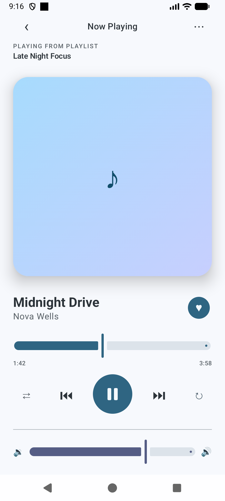
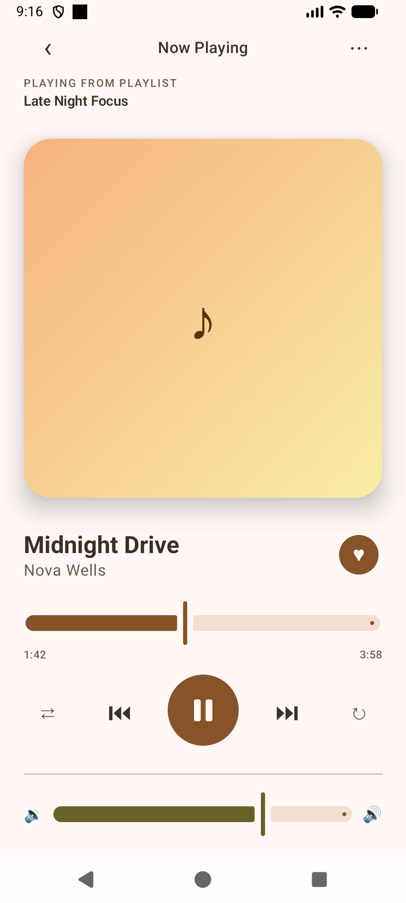
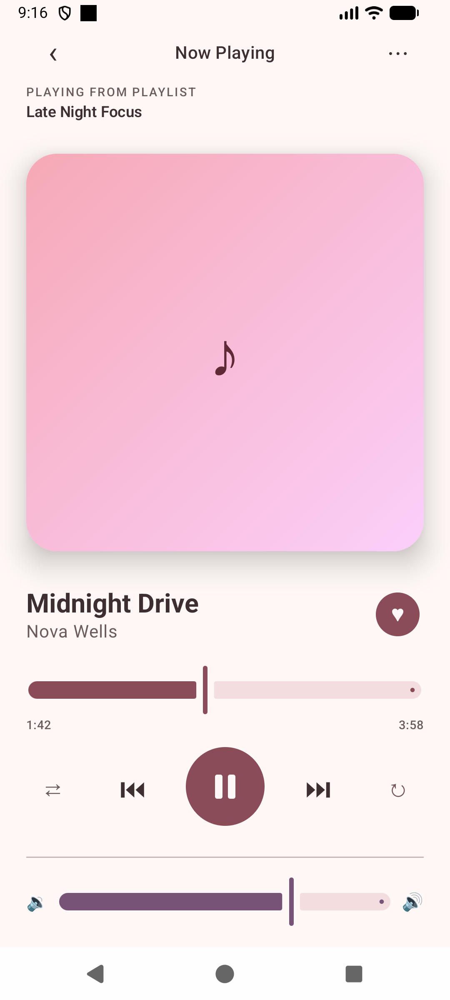
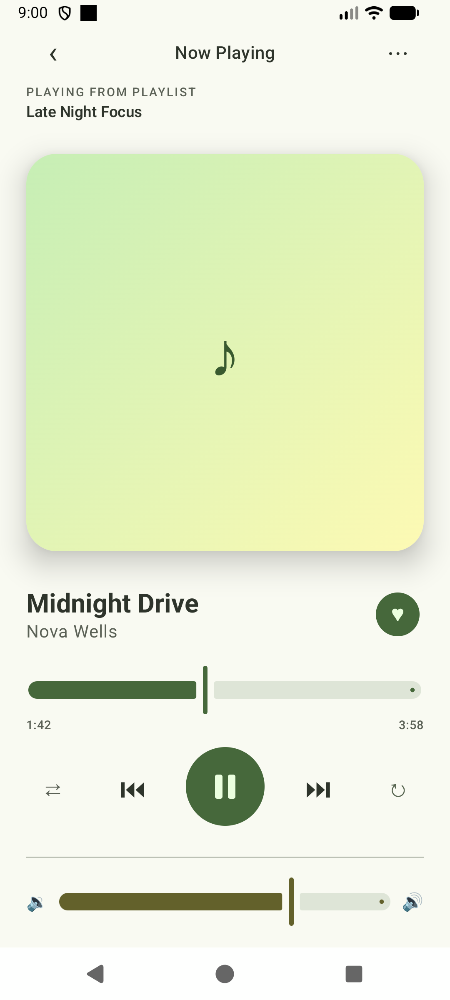

# Dynamic Color Demo

A Jetpack Compose demo of Material 3's **dynamic color**: every color on screen is generated
from the user's device wallpaper on Android 12+, with a static fallback theme below that.

### Same screen, different wallpapers

The screenshots below are the exact same screen and the exact same code, only the device
wallpaper changed between them:

| Wallpaper | App |
| --- | --- |
|  |  |
|  |  |
|  |  |
|  |  |

## What is this?

Material 3 can derive an app's entire color scheme from the wallpaper the user has set on their
device (aka "Material You" / dynamic color). This project is a single-screen showcase built to
make that mapping obvious: a "Now Playing" media player mockup where the artwork gradient, seek
and volume sliders, play/pause button, favorite toggle, shuffle/repeat controls, and chip are all
pulled from different roles of the same generated `ColorScheme` (`primary`, `secondary`,
`tertiary`, their container variants, `surfaceVariant`, `outline`, etc.); nothing is hardcoded.
Change the device wallpaper, relaunch, and the whole UI re-themes itself.

On devices below Android 12 (API 31), where wallpaper-based color extraction isn't available, the
app falls back to a static, hand-picked Deep Purple Material 3 seed scheme.

## Features

- Automatic detection of Android 12+ via `dynamicLightColorScheme` / `dynamicDarkColorScheme`
- Deep Purple seed-based fallback `ColorScheme` for pre-Android 12 devices
- A media-player-style layout exercising a wide range of Material 3 components across different
  color roles: `Slider` (×2), `FilledIconToggleButton`, `IconToggleButton`, `FilledIconButton`,
  `AssistChip`, `Surface`, `HorizontalDivider`
- Light and dark `@Preview`s
- **Zero third-party dependencies**, built entirely on `androidx.compose.material3`

## Tech stack

- Kotlin
- Jetpack Compose
- Material 3 (`androidx.compose.material3`)
- minSdk 24 · target/compileSdk 37

## Project structure

```
app/src/main/java/com/example/composedynamiccolordemo/
├── MainActivity.kt          # Now Playing screen and its composables
└── ui/theme/
    ├── Color.kt              # Deep Purple fallback seed palette
    ├── Theme.kt               # Dynamic color detection + MaterialTheme setup
    └── Type.kt                # Typography
```

## Running it

```bash
git clone git@github.com:nicolinx/compose-dynamic-color-demo.git
cd compose-dynamic-color-demo
./gradlew installDebug
```

Or just open the project in Android Studio and run the `app` configuration.

To see dynamic color in action, run it on an **Android 12+ device or emulator**, change the
wallpaper (Settings → Wallpaper & style), and relaunch the app.

## Author

**Nicodemus Lin** — Software Engineer

[](https://www.nicolin.dev/)
[](https://www.linkedin.com/in/nicodemus-lin/)
